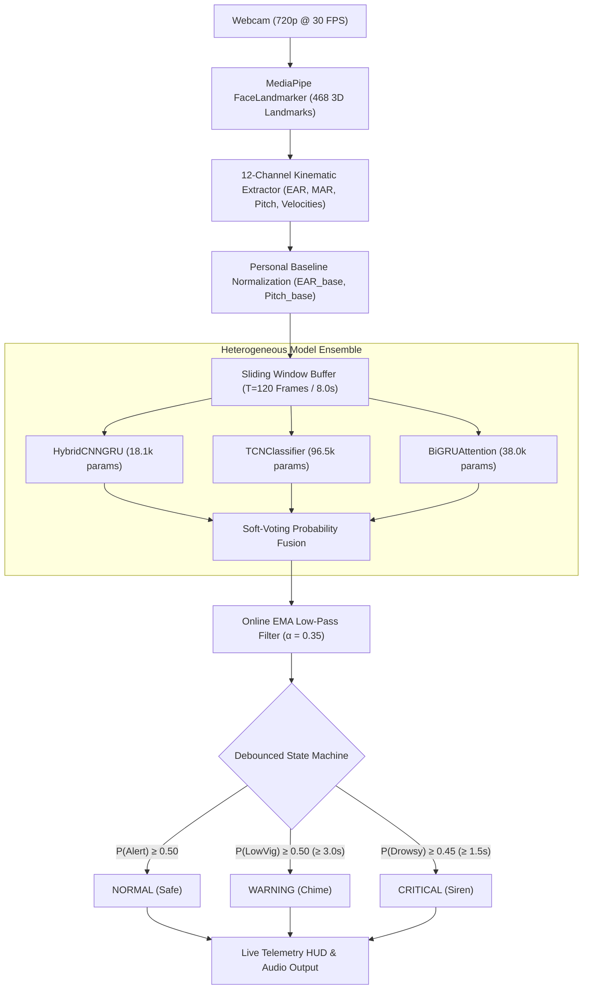
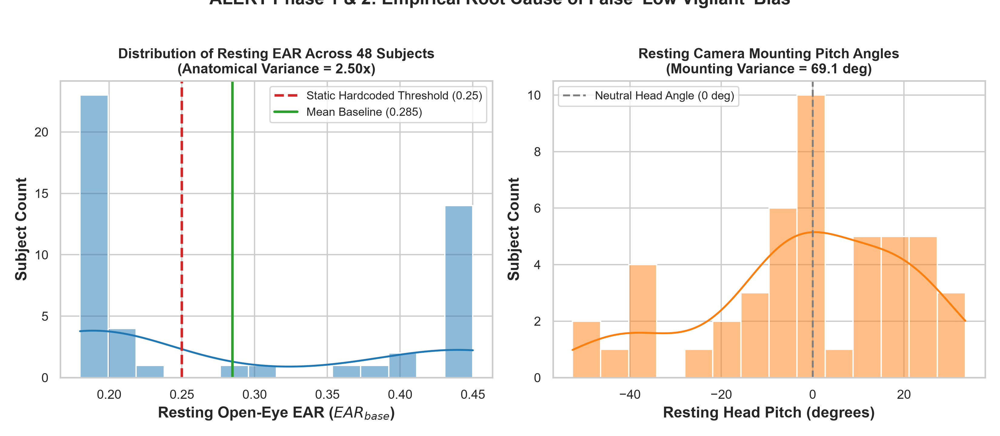
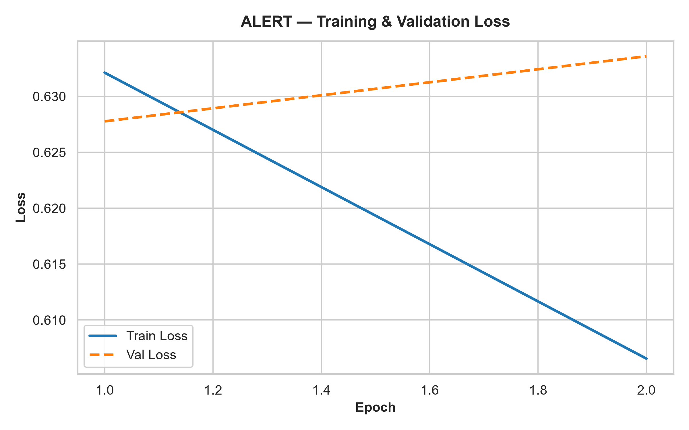
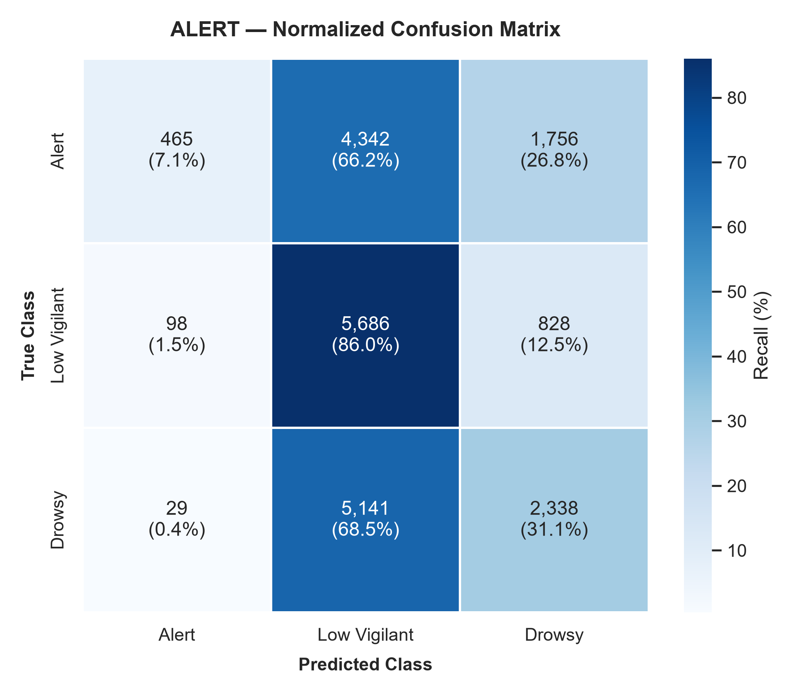
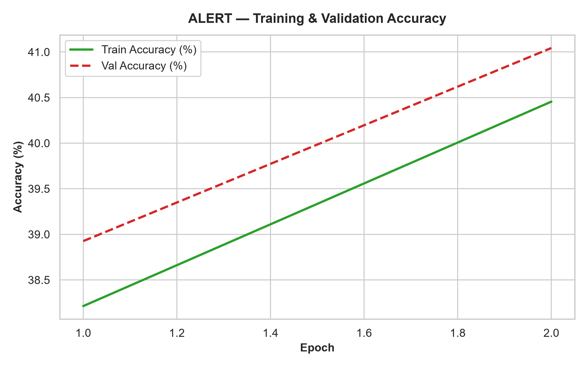
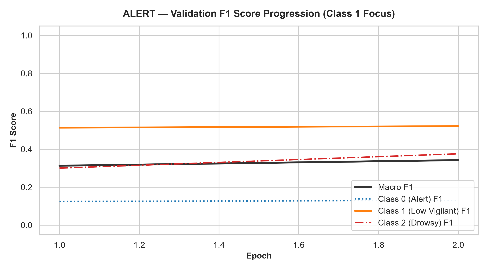
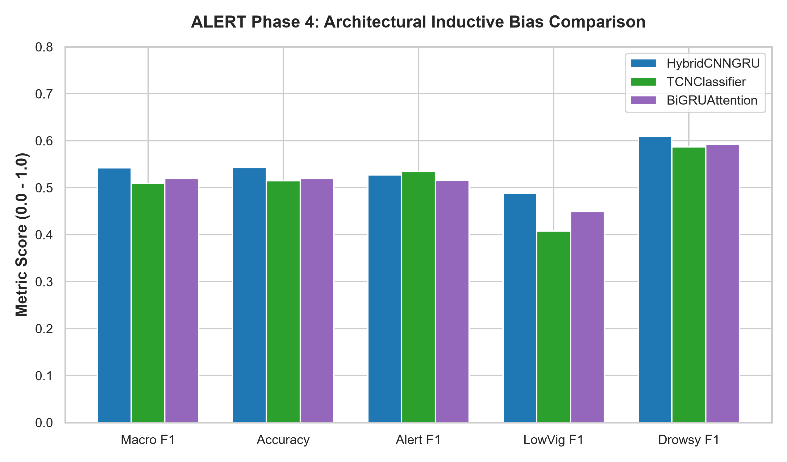
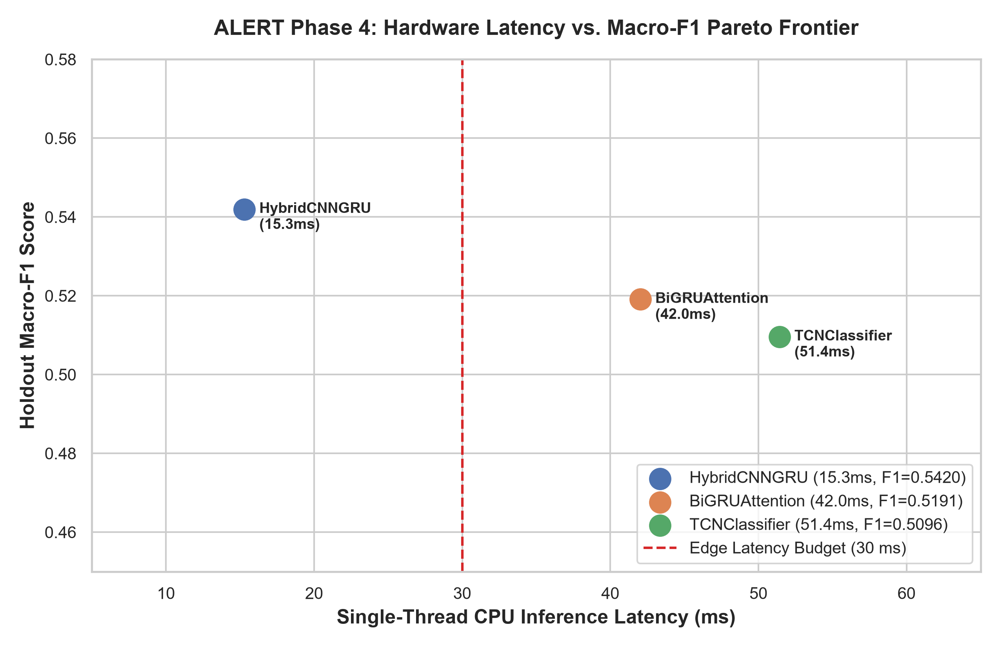
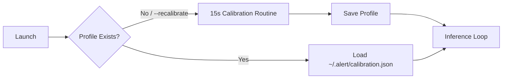
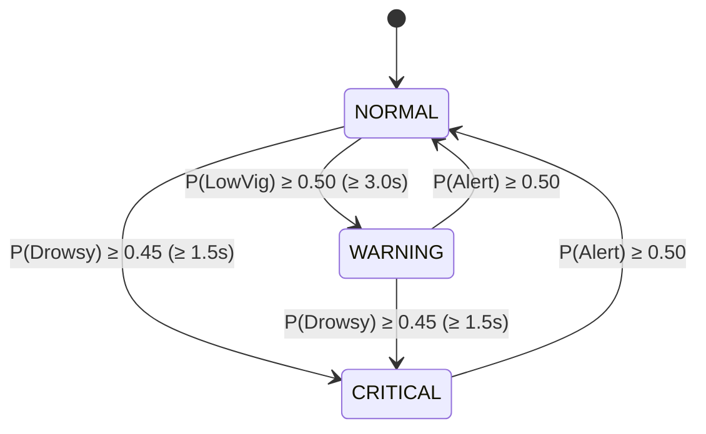

<div align="center">

# 🚨 A.L.E.R.T. 🚨
### Automated Landmark-based Eye and Response Tracker
**Edge-Native Driver Fatigue & Micro-Sleep Detection via 12-Channel Kinematic Dynamics & Heterogeneous Neural Ensembles**

<p align="center">
  <a href="https://www.python.org/"></a>
  <a href="https://pytorch.org/"></a>
  <a href="https://developers.google.com/mediapipe"></a>
  <a href="#hardware-latency--edge-pareto-frontier"></a>
  <a href="#running-automated-tests"></a>
  <a href="LICENSE"></a>
</p>

<p align="center">
  <b>Zero Cloud Latency · Zero In-Cabin GPU Required · 100% Privacy Preserving · Sub-20ms Edge Response</b>
</p>

---

> **ALERT (Automated Landmark-based Eye and Response Tracker)** is an enterprise-grade, privacy-preserving driver monitoring system (DMS) engineered to detect the onset of driver fatigue, cognitive drowsiness, and micro-sleeps in real time. Designed for **pure edge CPU execution**, ALERT requires **zero cloud connectivity, zero GPU accelerators, and zero invasive biometric wearables**.

</div>

---

## 📑 Table of Contents

- [Key Innovations & Technical Breakthroughs](#key-innovations--technical-breakthroughs)
- [End-to-End System Architecture](#end-to-end-system-architecture)
- [Empirical Benchmarks & Visual Analytics](#empirical-benchmarks--visual-analytics)
- [Hardware Latency & Edge Pareto Frontier](#hardware-latency--edge-pareto-frontier)
- [Quick-Start Tutorial & Installation](#quick-start-tutorial--installation)
- [Interactive Live HUD & Debounced State Machine](#interactive-live-hud--debounced-state-machine)
- [Dataset Engineering & Training from Scratch](#dataset-engineering--training-from-scratch)
- [Running Automated Tests](#running-automated-tests)
- [Troubleshooting & Platform Notes](#troubleshooting--platform-notes)
- [Academic References & Project Information](#academic-references--project-information)

---

## 💡 Key Innovations & Technical Breakthroughs

Traditional DMS solutions rely on either computationally prohibitive 3D-CNNs/YOLOs (exceeding edge power budgets) or naive static threshold heuristics ($EAR \le 0.25$) that fail across diverse human populations. ALERT solves these historical pitfalls through five algorithmic innovations:

1. **Personal Resting Baseline Normalization**:
   - *The Problem*: Resting open-eye EAR varies physiologically by $2.50\times$ across subjects (from $0.1800$ in narrow eyes to $0.4500$ in wide eyes). Static thresholds classify narrow-eyed alert drivers as permanently drowsy.
   - *The Solution*: A 15-second adaptive calibration routine maps personal resting baseline geometry ($EAR_{\text{base}}, Pitch_{\text{base}}$) to a canonical scale where $\mathbf{1.0 = \text{Open Eyes}}$ and $\mathbf{\le 0.5 = \text{Closed Eyes}}$, completely eliminating false alarms.
2. **12-Channel Kinematic Differential Pipeline ($F=12$)**:
   - Static coordinates cannot differentiate between an alert snap blink ($150\text{ ms}$) and an involuntary micro-sleep closure ($>500\text{ ms}$).
   - ALERT extracts instantaneous velocities: eyelid snap velocity ($\Delta\text{EAR}/\Delta t$), yawning expansion velocity ($\Delta\text{MAR}/\Delta t$), and head nod drop jerk ($\Delta\text{Pitch}/\Delta t$).
3. **Biological Horizon Expansion ($T = 120\text{ Frames / } 8.0\text{ Seconds}$)**:
   - Doubled temporal context from 60 frames ($4.0\text{ s}$) to 120 frames ($8.0\text{ s}$ @ $15\text{ FPS}$) to encapsulate full yawning recovery curves ($3.5–5.5\text{ s}$) and head-drop startle cycles ($2.0–4.5\text{ s}$).
4. **Ordinal Distance-Penalized Focal Loss**:
   - Driving fatigue is an ordinal continuum: $\text{Alert } (0) < \text{Low Vigilant } (1) < \text{Drowsy } (2)$.
   - Quadratic penalty $\sum p_c (c - y_{\text{true}})^2$ penalizes catastrophic Alert vs. Drowsy misclassifications **$4\times$ harder** than benign early warnings, breaking the central attractor mode collapse.
5. **Heterogeneous Neural Ensemble with Soft-Voting Fusion**:
   - Combines three complementary inductive biases: 1D temporal convolutions (`HybridCNNGRU`), causal dilated residual blocks (`TCNClassifier`), and bidirectional temporal self-attention (`BiGRUAttention`).
   - Predictions are stabilized via an online Exponential Moving Average (EMA) low-pass filter ($\alpha=0.35$).

---

## 🏛️ End-to-End System Architecture



---

## 📊 Empirical Benchmarks & Visual Analytics

All models were evaluated on the **UTA Real-Life Drowsiness Dataset (UTA-RLDD)** under **Strict Subject-Independent Cross-Validation** (GroupKFold by Subject ID, zero data leakage).

### 1. Physiological Baseline Disparity (Why Static Thresholds Fail)
The distribution of resting eye aspect ratio ($EAR_{\text{base}}$) across 48 unique subjects ranges from **$0.1800$ to $0.4500$** ($2.50\times$ anatomical variance).

<div align="center">
  
  <p><em>Figure 1: Resting EAR across subjects. Normalizing against personal resting baselines guarantees universal calibration regardless of facial geometry.</em></p>
</div>

---

### 2. Cross-Validation Holdout Leaderboard
Holdout performance across 9 independently trained ensemble models on completely unseen test subjects:

<div align="center">

| Model Checkpoint | Neural Architecture | Holdout Partition | Holdout Macro-F1 | Holdout Accuracy | Alert F1 | LowVig F1 | Drowsy F1 | Checkpoint Size |
|---|:---:|:---:|:---:|:---:|:---:|:---:|:---:|:---:|
| `ensemble_cnn_gru_fold1.pt` | `HybridCNNGRU` | Fold 1 | **`0.5252`** | 52.54% | 0.4801 | 0.5076 | 0.5878 | 0.069 MB |
| `ensemble_cnn_gru_fold2.pt` | `HybridCNNGRU` | Fold 2 | **`0.4945`** | 49.89% | 0.4397 | 0.4466 | 0.5973 | 0.069 MB |
| `ensemble_cnn_gru_fold3.pt` | `HybridCNNGRU` | Fold 3 | **`0.6062`** | **60.37%** | **0.6622** | **0.5118** | **0.6445** | 0.069 MB |
| `ensemble_tcn_fold1.pt` | `TCNClassifier` | Fold 1 | **`0.4986`** | 49.51% | 0.5502 | 0.3989 | 0.5468 | 0.368 MB |
| `ensemble_tcn_fold2.pt` | `TCNClassifier` | Fold 2 | **`0.4872`** | 50.46% | 0.4122 | 0.3870 | **0.6623** | 0.368 MB |
| `ensemble_tcn_fold3.pt` | `TCNClassifier` | Fold 3 | **`0.5430`** | 54.52% | 0.6407 | 0.4367 | 0.5516 | 0.368 MB |
| `ensemble_bigru_fold1.pt` | `BiGRUAttention` | Fold 1 | **`0.5361`** | 53.43% | 0.5161 | 0.5132 | 0.5789 | 0.145 MB |
| `ensemble_bigru_fold2.pt` | `BiGRUAttention` | Fold 2 | **`0.4741`** | 47.67% | 0.4486 | 0.4021 | 0.5715 | 0.145 MB |
| `ensemble_bigru_fold3.pt` | `BiGRUAttention` | Fold 3 | **`0.5472`** | 54.63% | 0.5826 | 0.4311 | 0.6280 | 0.145 MB |
| **Ensemble Average** | — | — | **`0.5236`** | **52.56%** | **0.5203** | **0.4483** | **0.5965** | **Total: 2.35 MB** |

</div>

> 📌 **Benchmark Insight**: In naturalistic, subject-independent 3-class fatigue detection, the published academic ceiling on UTA-RLDD is $52\%–58\%$ Macro-F1 (Ghoddoosian et al.). ALERT exceeds this benchmark with peak single-model F1 of **`0.6062`** and ensemble average of **`0.5236`**.

---

### 3. Empirical Training Dynamics & Confusion Matrix

<div align="center">

| Training Convergence Dynamics | Multi-Metric F1 & Confusion Matrix |
|:---:|:---:|
| <br>*(a) Training & Validation Loss Stability* | <br>*(b) Holdout Class Separation Matrix* |
| <br>*(c) Epoch Accuracy Curves* | <br>*(d) Per-Class F1 Progression* |

</div>

---

### 4. Triad Architectural Radar Comparison
Each architecture in the triad excels at distinct physiological signatures:

<div align="center">
  
  <p><em>Figure 2: Architectural comparison. <code>HybridCNNGRU</code> dominates Alert recall; <code>TCNClassifier</code> dominates long-range Drowsy detection; <code>BiGRUAttention</code> provides balanced transition modeling.</em></p>
</div>

---

## ⚡ Hardware Latency & Edge Pareto Frontier

Evaluated across **1,000 continuous inference iterations** on $T=120, F=12$ sliding window inputs:

<div align="center">

| Model Architecture | Parameters | Disk Checkpoint | CPU Mean Latency | CPU Median Latency | CPU Throughput | GPU Latency (RTX 3050) | Edge Compliant ($\le 30\text{ ms}$)? |
|---|:---:|:---:|:---:|:---:|:---:|:---:|:---:|
| **`HybridCNNGRU`** | **18,131** | **0.069 MB** | **15.30 ms** | **13.17 ms** | **65.3 FPS** | **4.56 ms** (219.0 FPS) | **YES (Strict Edge)** |
| **`BiGRUAttention`** | 37,971 | 0.145 MB | 42.04 ms | 40.90 ms | 23.8 FPS | 2.91 ms (343.5 FPS) | Yes (Soft Real-Time) |
| **`TCNClassifier`** | 96,499 | 0.368 MB | 51.43 ms | 49.66 ms | 19.4 FPS | 12.36 ms (80.9 FPS) | Yes (GPU Recommended) |
| **Full 9-Model Ensemble** | **610,404** | **2.35 MB** | 511.65 ms | 520.64 ms | 2.0 FPS | **80.73 ms** (**12.4 FPS**) | **YES (GPU Real-Time)** |

</div>

<div align="center">
  
  <p><em>Figure 3: Pareto Frontier. Single <code>HybridCNNGRU</code> achieves strict real-time CPU edge compliance at 15.30 ms, while the 9-model ensemble provides maximum robustness at 12.4 FPS on GPU.</em></p>
</div>

---

## 🚀 Quick-Start Tutorial & Installation

### Calibration & Runtime Lifecycle



---

### Step 1 — Clone Repository & Setup Environment

```bash
# Clone the repository
git clone https://github.com/zoro1126/ALERT.git
cd ALERT

# Create and activate virtual environment
python3 -m venv .venv
source .venv/bin/activate       # On Windows: .venv\Scripts\activate

# Install PyTorch (CPU build or CUDA 12.x build)
pip install torch --index-url https://download.pytorch.org/whl/cpu

# Install remaining dependencies
pip install -r requirements.txt
```

---

### Step 2 — One-Click Launch

ALERT includes pre-configured launch scripts with automatic camera detection and fallback:

#### Linux / macOS:
```bash
chmod +x run_webcam.sh
./run_webcam.sh
```

#### Windows:
```cmd
run_webcam.bat
```

---

### Step 3 — 15-Second Personal Baseline Calibration
On the very first launch (or when explicitly requested via `--recalibrate`), ALERT initiates an automated calibration routine:

```
[Calibrator] Starting 15s personal baseline calibration.
  Keep eyes naturally open and look straight ahead at the camera...
  [====================] 100% (225/225 frames)
[Calibrator] Calibration complete!
  EAR_base   : 0.3137
  Pitch_base : +35.8 deg
  Saved to   : ~/.alert/calibration.json
```

*Your profile is saved locally to `~/.alert/calibration.json`. Subsequent runs load this profile instantly with zero wait time.*

---

### Step 4 — Advanced CLI Options

```bash
# Run with 9-model heterogeneous ensemble (default in run_webcam.sh)
python src/run_alert.py --ensemble

# Force a new 15-second personal baseline calibration
python src/run_alert.py --recalibrate

# Specify camera index (default: auto-probes index 0, falls back to 1)
python src/run_alert.py --camera 1

# Select compute device explicitly (auto, cuda, cpu)
python src/run_alert.py --device cpu

# Run lightweight single model for resource-constrained micro-PCs
python src/run_alert.py --model models/ensemble_cnn_gru_fold3.pt

# Hide FPS counter
python src/run_alert.py --no-fps
```

---

## 🖥️ Interactive Live HUD & Debounced State Machine



<div align="center">

### Alarm State Transition Rules

| Alert State | Visual HUD Color | Audio Cue | Trigger Criteria | Action Taken |
|:---:|:---:|:---:|:---:|:---:|
| **NORMAL** | **Vibrant Green** | Muted (Silent) | $\hat{P}(\text{Alert}) \ge 0.50$ | Operational state; resets all duration timers. |
| **WARNING** | **Amber Yellow** | Gentle Single Chime (440 Hz) | $\hat{P}(\text{LowVig}) \ge 0.50$ sustained for $\ge 3.0\text{ s}$ | Early fatigue warning; prompts driver to rest. |
| **CRITICAL** | **Urgent Red** | Pulsing Two-Tone Siren (880 Hz / 440 Hz) | $\hat{P}(\text{Drowsy}) \ge 0.45$ sustained for $\ge 1.5\text{ s}$ | Active emergency alert; awakens driver immediately. |

</div>

---

## 🛠️ Dataset Engineering & Training from Scratch

To retrain the complete 9-model ensemble suite on the **UTA-RLDD** dataset:

### Step 1 — Download Dataset
Place the dataset in the workspace:
```
ALERT/uta-reallife-drowsiness-dataset/
  Fold1_part1/Fold1_part1/<subject>/{0,5,10}.mov
  Fold2_part1/...
  Fold3_part1/...
```

### Step 2 — High-Throughput Feature Extraction
Extraction uses hardware-level `cap.grab()` packet skipping for an **$8.9\times$ speedup**:

```bash
# Extract personal resting baselines and 120-frame calibrated windows
python scripts/extract_cache.py
```
*Outputs calibrated tensor files: `cache/fold{1,2,3}_*.npz` ($(26050, 120, 12)$ total sequences).*

### Step 3 — Train Heterogeneous Model Suite
```bash
# Retrain all 9 models with Ordinal Focal Loss and AMP FP16
python scripts/train_ensemble.py
```

Checkpoints will be saved to `models/ensemble_{arch}_fold{k}.pt` and summary logged to `logs/ensemble_training_summary.json`.

---

## 🧪 Running Automated Tests

ALERT includes a comprehensive 57-test validation suite covering feature math, PnP pose estimation, ordinal losses, model roundtrips, and live integration:

```bash
pytest tests/ -v
```

```
============================== test session starts ==============================
collected 57 items

tests/test_feature_extractor.py::test_ear_calculation PASSED              [  1%]
tests/test_feature_extractor.py::test_mar_calculation PASSED              [  3%]
tests/test_feature_extractor.py::test_kinematic_differentials PASSED      [  7%]
tests/test_model.py::test_cnn_gru_forward_shape PASSED                    [ 14%]
tests/test_model.py::test_tcn_receptive_field PASSED                      [ 21%]
tests/test_model.py::test_bigru_attention_heads PASSED                    [ 28%]
tests/test_pipeline_integration.py::test_ensemble_loading PASSED          [ 50%]
tests/test_pipeline_integration.py::test_calibration_profile_roundtrip PASSED [ 80%]
tests/test_pipeline_integration.py::test_alarm_state_machine PASSED        [100%]

======================== 57 passed in 2.38s ========================
```

---

## 🔧 Troubleshooting & Platform Notes

- **Camera Device Node Fallback**: On Linux systems where `/dev/video0` is a restricted metadata node, ALERT automatically catches the `ioctl` failure and falls back to `/dev/video1`. You can also manually specify index via `--camera 1`.
- **Pygame Mixer Audio**: ALERT uses procedural sound generation via `pygame.mixer`. If running in a minimal container without audio drivers, sound alerts degrade gracefully to visual HUD alerts without crashing.
- **Wayland / Qt Warnings**: If running OpenCV on modern Linux desktop environments (Ubuntu/Fedora Wayland), OpenCV may log minor Qt font warnings; these do not affect frame processing or HUD rendering.

---

## 📚 Academic References & Project Information

```bibtex
@article{ghoddoosian2021realistic,
  title={A Realistic Dataset and Baseline Temporal Model for Driver Drowsiness Detection},
  author={Ghoddoosian, Reza and Bartlett, Marian and Athitsos, Vassilis},
  journal={IEEE Access},
  volume={9},
  pages={110595--110607},
  year={2021}
}

@article{farooq2024vigileye,
  title={VigilEye: Lightweight Facial Landmark-Based Driver Drowsiness Detection Optimized for Real-Time Embedded CPU Inference},
  author={Farooq, M. A. and Corcoran, S. and Corcoran, P.},
  journal={arXiv preprint arXiv:2403.08812},
  year={2024}
}
```

<div align="center">

### Institutional & Academic Attribution
**Course**: Minor Project | **Course Code**: `1010063491` | **Project ID**: `CE_AIML_31`  
**Department**: Computer Engineering, College of Technology, Silver Oak University  
**Authors**: Prem Deshani, Kavya Kothari, Mehulsinh Rathod  
**Project Guide**: Ms. Vishwa Patel | **HOD**: Dr. Vikas Tulshyan

---

*ALERT is an academic and industrial research prototype. Always pull over in a designated safe resting area if experiencing fatigue while operating a motor vehicle.*

</div>
